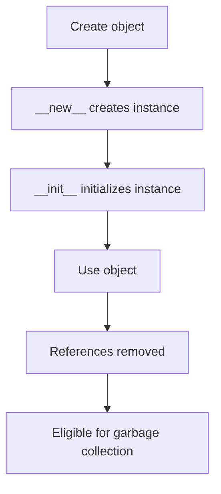
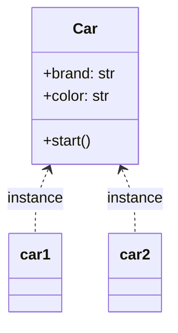

# Python OOP Fundamentals

## 1. Introduction

Object-Oriented Programming (OOP) is a programming
approach that organizes software using classes and objects.

OOP improves code reuse, maintainability, and extensibility.

Real-world example:
A car has properties such as brand and color, and
behaviors such as starting and stopping.

## 2. Classes and Objects

A class is a blueprint. An object is an instance of a class.

```python
class Car:
    def __init__(self, brand: str, color: str) -> None:
        self.brand = brand
        self.color = color

    def start(self) -> None:
        print(f"{self.brand} is starting")


car1 = Car("Toyota", "White")
car1.start()
print(car1.color)
```

Output:
Toyota is starting
White

Real-world example:
Car is the class. A white Toyota and a black Honda
are different objects created from a class.

## 3. Constructors: __init__()

The __init__ method initializes an object after it has
been created. It commonly assigns initial attribute values.

```python
class Student:
    def __init__(self, name: str, roll_no: int) -> None:
        self.name = name
        self.roll_no = roll_no


student = Student("Vinith", 101)
print(student.name, student.roll_no)
```

Output:
Vinith 101

## 4. Instance and Class Variables

Instance variables belong to individual objects.
Class variables are defined on the class and are shared
unless an object or subclass overrides them.

```python
class Employee:
    company = "ABC Technologies"

    def __init__(self, name: str) -> None:
        self.name = name


e1 = Employee("Ravi")
e2 = Employee("Vinith")

print(e1.name)
print(e2.name)
print(e1.company)
print(Employee.company)
```

Output:
Ravi
Vinith
ABC Technologies
ABC Technologies

## 5. Instance, Class, and Static Methods

An instance method receives self.
A class method receives cls and uses @classmethod.
A static method has no automatic self or cls argument.

```python
class Employee:
    company = "ABC Technologies"

    def __init__(self, name: str) -> None:
        self.name = name

    def greet(self) -> str:
        return f"Hello, {self.name}"

    @classmethod
    def get_company(cls) -> str:
        return cls.company

    @staticmethod
    def is_valid_name(name: str) -> bool:
        return bool(name.strip())


employee = Employee("Vinith")
print(employee.greet())
print(Employee.get_company())
print(Employee.is_valid_name("Vinith"))
```

Output:
Hello, Vinith
ABC Technologies
True

## 6. self and cls

self refers to the current instance of a class.
It is commonly used to access instance attributes and methods.

cls refers to the class itself.
It is commonly used by class methods to access class-level
data or create alternative constructors.

Comparison:
- self: current object
- cls: current class

## 7. Object Lifecycle

An object's lifecycle includes creation, initialization,
use, and eventual cleanup.



Python calls __new__ to create an instance and __init__
to initialize it. When an object is no longer reachable,
it may be eligible for garbage collection. Exact cleanup
timing is implementation-dependent.

## 8. Class and Object Diagram



The class defines structure and behavior.
Each object has its own instance attributes.

## 9. Comparisons

| Concept | Meaning |
|---|---|
| Class vs object | Blueprint vs instance |
| Instance variable vs class variable | Object-specific vs class-level data |
| Instance method vs class method | Uses self vs uses cls |
| Class method vs static method | Receives cls vs no automatic first argument |
| __new__ vs __init__ | Creates instance vs initializes instance |

## 10. Benefits of OOP

- Reuse behavior through classes and inheritance.
- Keep related data and behavior together.
- Protect object state through controlled interfaces.
- Make applications easier to maintain and extend.
- Model real-world entities in a structured way.
